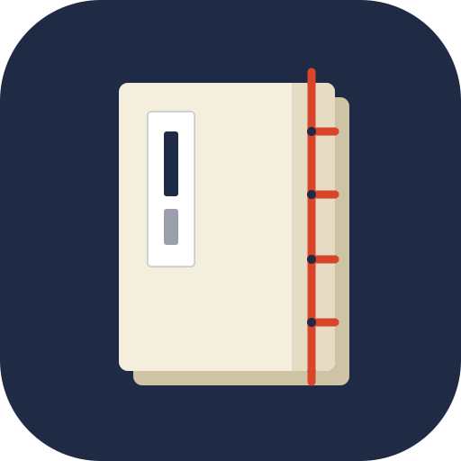

<p align="center">
  
</p>

<h1 align="center">Tsuzuri 綴り</h1>

<p align="center">
  <em>Read, understand and bind the comics and books you own.</em><br>
  iPhone · iPad · Mac
</p>

---

## About

**Tsuzuri** (綴り) is Japanese for *binding pages together*, and also for *composing writing*. The app does both.

It is a native SwiftUI app for iPhone, iPad and Mac for reading, translating, narrating and editing the comics and books you already own. It starts as a **Panel Reader** for raw Japanese manga, then grows into a full **EPUB reader and editor** in the spirit of Calibre, written from scratch for Apple platforms.

The logo shows *yotsume toji* (四つ目綴じ), the traditional Japanese four-hole stab binding. The book is bound on the right because Japanese books are read right to left.

## Principles

- **Your content, your devices.** No built-in stores, catalogues or manga sources. You import files you own.
- **On-device first.** Import, Library, editing, horizontal OCR, Apple Translation and Read-aloud are free and run locally.
- **Cloud only when the device can't do the job, and always paid.** Vertical-text OCR and AI Renders go through our backend; we never subsidise AI use.
- **Private by design.** Page content lives only on your devices and in your iCloud. The backend keeps your Apple account ID, entitlement and usage, nothing else.
- **No Calibre or GPL code.** Every feature is built from scratch; dependencies are permissively licensed only.

## Features

### R1 · Panel Reader (launch)

- **Import** CBZ, ZIP, image folders, PDF and EPUB into a single **Library** of comics and books.
- **Comic structure editing:** split, merge and reorder Chapters, Pages and Panels, with undo.
- **Automatic Panel detection,** including borderless, slanted and two-Page Panels, with manual adjustment.
- **OCR and translation:** horizontal text on device; vertical Japanese text via paid cloud OCR; translation via Apple Translation.
- **Read-aloud:** live on-device speech of each Panel's Lines.
- **Player:** step through a Chapter Panel by Panel in reading order.
- **Reading modes:**
  - *Story mode*: target-language narration and subtitles.
  - *Learn mode*: source-language narration with furigana and translated subtitles.
- **Cast:** tag Characters so they look and sound the same across Renders.
- **Renders:** optional, paid, AI-acted videos of 1–10 consecutive Panels, watched only in the app and backed up to your iCloud.
- **iCloud sync** across all your devices.

### Roadmap

| Phase | Name | Highlights |
|---|---|---|
| R1.1 | Learner Tools | Tap-to-lookup dictionary, saved words, Anki export |
| R1.5 | Metadata Editor Lite | Edit EPUB title, author, series and cover; send to Apple Books |
| R2 | EPUB Reader + Read-aloud | Reflowable EPUB reading with Read-aloud and highlighting |
| R3 | Full Metadata Editor | All OPF metadata, web metadata lookup, bulk edit |
| R4 | Conversion | CBZ/CBR, DOCX, TXT/HTML/Markdown, text PDF, FB2, DRM-free MOBI/AZW3 → EPUB |
| R5 | Content Editor | HTML/CSS and table of contents editing, regex find/replace, book checker (iPad and Mac) |

Source language is Japanese at launch, with Korean and Chinese to follow. Target and UI language is English at launch.

## Requirements

- iOS / iPadOS 18 or later
- macOS 15 or later

## Project docs

- [`CONTEXT.md`](CONTEXT.md): domain glossary. Use these terms in code and UI.
- [`specs/00-overview.md`](specs/00-overview.md): product, phases, architecture and module map.
- [`docs/adr/`](docs/adr/): architecture decision records.

## Development

One Swift package per module under [`Packages/`](Packages/) (ADR 0002). Run every package's tests, or one:

```bash
scripts/test.sh
scripts/test.sh ComicStructure
```

Works with Xcode or with the Command Line Tools alone. Shared fixtures live in [`Fixtures/golden/`](Fixtures/golden/); security controls in [`security/`](security/).

## Status

Pre-alpha. M1 (Foundations) in progress: `ComicStructure` v1 and a local `Persistence` store are in place.
